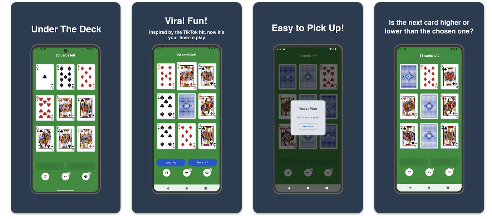
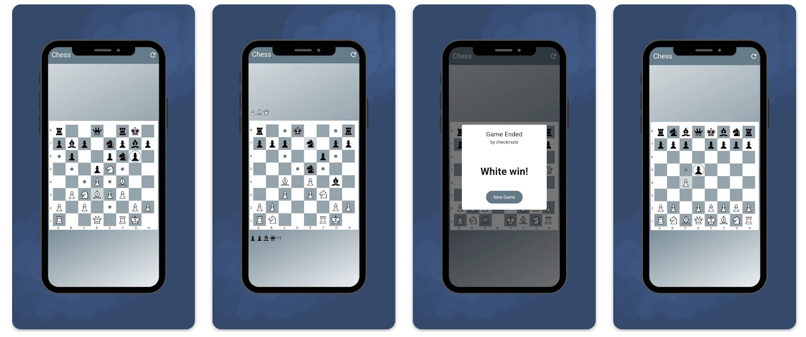

Staff-level Android engineer with 8+ years of experience building scalable apps, SDKs, and developer tools used by millions. Lead Android streams, designed core libraries, optimized performance (cut CPU by 64%, memory by 30%), and drive system migrations (Java → Kotlin, Rx → Coroutines). Passionate about mentorship, architecture, and creating strong developer culture.

I'm consulting different startups all over the world. I offer mobile architecture design, gathering server-side requirements, finding optimal solutions for your businesses, helping with gathering staffing requirements.

I also have a couple of pet-projects that I create for myself. I'm passionate about chess and over the board games. One day I've noticed a great game in TikTok and digitalized it for myself. Here's a list of games I created to play with my friends:

## Under The Deck (Android, Jetpack Compose, Kotlin) - [play store link](https://play.google.com/store/apps/details?id=com.dnl.underthedeck)

## Chess Master (Flutter, Dart) - [play store link](https://play.google.com/store/apps/details?id=com.moshenskyi.chessmaster)
