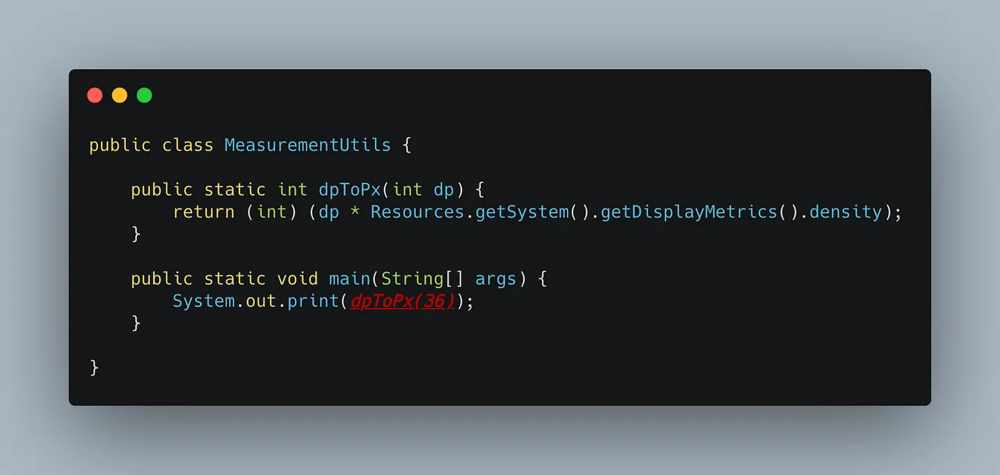
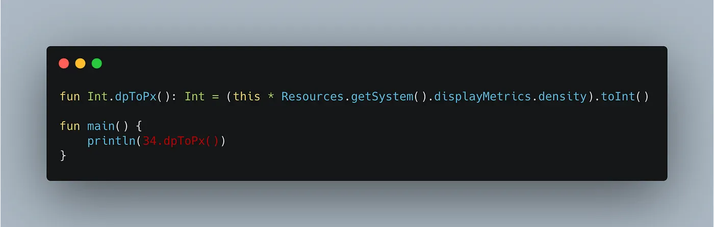
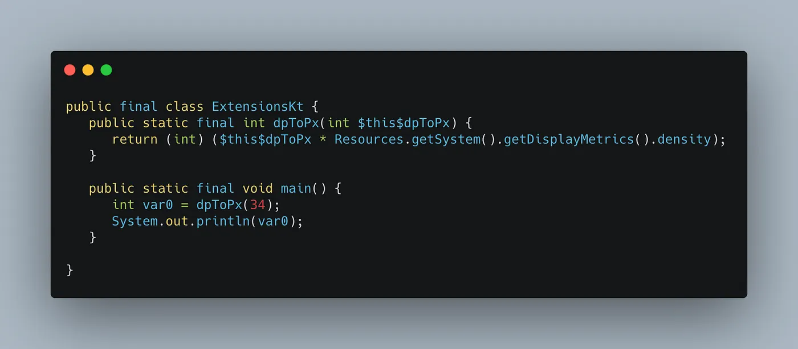
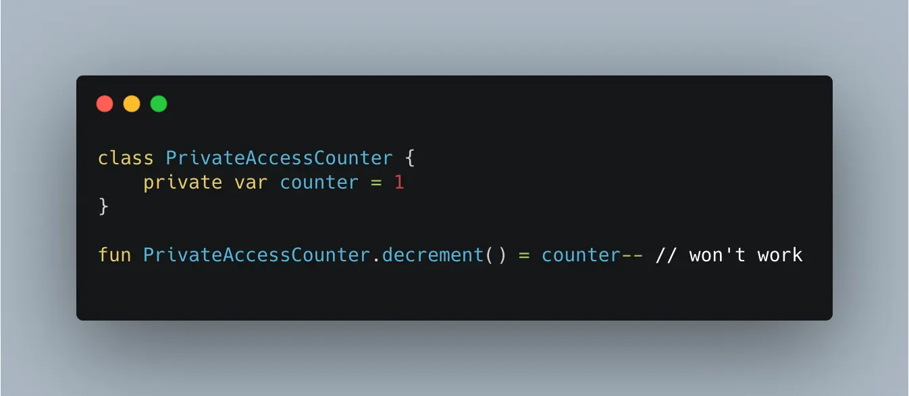
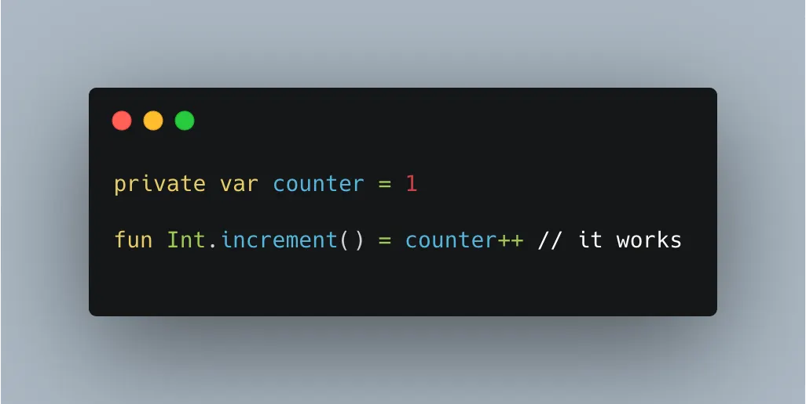

All of you probably noticed how fast **utils** folders grow in newly created projects. Some developers have templates for starting projects where they hold some Gradle tasks or basic project structure. Eventually, among them, you can find util classes for closing keyboard and so on.

We hold their helper methods which are needed to fulfill missing features from the original API.

Let’s say we want to create a very useful util method for converting density-independent pixels(**dp**) into pixels(**px**). In Java we can create the following method:

We need a class for it as Java doesn’t allow  **top-level functions**  and we have a static method with one parameter. It’s ok, but take a look at the  **red**  piece of code. I don't like the way we call this method. It creates “abstraction” over  **integer** and  **extends its API**.

What if we could add this method to  **integer**  implementation? In Kotlin we could simulate it:

We’ve created an extension method for the **Int** class and in the **main** method we called the conversion method as if it existed inside **Int** API. Looks very handy. We got rid of parameters, unnecessary class, and this code makes us feel as we are working with a **density-independent pixel instance** and call its own method. Perfect!

But technically this code doesn’t insert any method into **Int** class:

As always, I simplified generated code a bit and you might notice that it generates the same code as we wrote in Java but makes our extension function  **static final**. So, this extension is just syntactic sugar.

Also, in Kotlin's version, we didn’t create any class and used a top-level function. In generated code we see a created class named {filename + Kt}.

## Must know facts

1.  **private**  members of the  **receiver class** can’t be accessed inside the extension function.

That’s because we  **do not**  insert any code inside  **PrivateAccessCounter**  class by creating the extension function. Under the hood, we just create a static method that uses this class.

2.  **private**  members defined  **inside the same file or class**  as extension function can be accessed:

3. In line with functions you can extend  **Companion**  objects and add them some methods,  **properties**,  **nullable types**.

Let me know if you have any questions — I’ll be happy to address then in future articles. If it was helpful, feel free to follow me here or on [LinkedIn](https://www.linkedin.com/in/nazarii-moshenskyi/).
