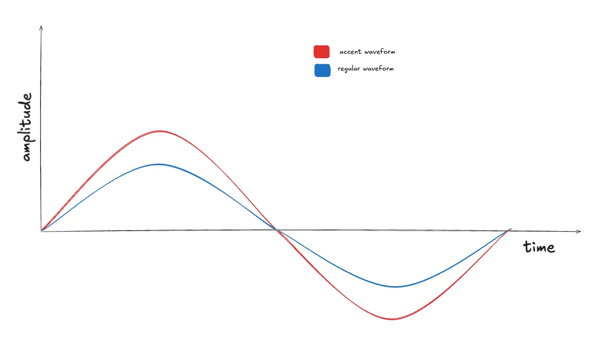
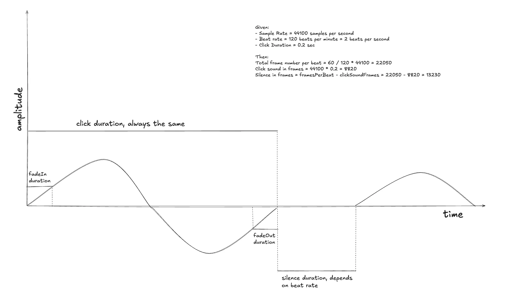

In the world of audio applications, timing precision is crucial. A metronome is a perfect example of an app that requires accurate timing to produce rhythmic beats consistently. In this article, we’ll explore how to build a sample-accurate metronome in Android using `AudioTrack` instead of relying on `delay()`, and how to generate waveforms programmatically.

## Why Not Use Delay?

When building a metronome, it’s tempting to use `delay()` or `Handler.postDelayed()` to schedule beats. However, these approaches depend on the system clock, which is susceptible to timing drift due to CPU scheduling, garbage collection, and other OS activities. This can result in inconsistent beat timing, especially noticeable over extended periods.

Instead, a more robust solution is to use `AudioTrack` with PCM frame counting, achieving precision down to the sample level. This approach leverages the sample rate to schedule beats with sub-millisecond accuracy, eliminating jitter and timing drift.

## Understanding AudioTrack and PCM

`AudioTrack` is a low-level API that allows developers to write raw PCM audio data to a playback buffer. PCM (Pulse Code Modulation) data represents audio as a series of samples, where each sample is a discrete amplitude value.

For our metronome, we will generate these samples programmatically using sinusoidal waveforms. This allows us to synthesize metronome clicks at precise intervals, ensuring consistent beat timing.

## Implementing a Sample-Accurate Metronome

Instead of using `delay()` to schedule beats, we calculate the number of frames per beat based on the BPM and sample rate. We then count frames to determine when each beat should occur, ensuring precise timing without relying on the system clock.

Here’s a brief overview of the implementation steps:
1.  Initialize  `AudioTrack`  in streaming mode.
2.  Generate a waveform buffer with a ticking sound.
3.  Calculate frames per beat based on BPM and sample rate.
4.  Stream click and silence buffers to  `AudioTrack`  maintain beat consistency.

## Setting Up AudioTrack

First, we initialize the  `AudioTrack`  object in streaming mode, allowing us to write audio data dynamically:

``` kotlin
private  fun initAudioTrack(sampleRate: Int, bufferSize: Int): AudioTrack {  
	return AudioTrack(  
		AudioManager.STREAM_MUSIC,  
		sampleRate,  
		AudioFormat.CHANNEL_OUT_MONO,  
		AudioFormat.ENCODING_PCM_16BIT,  
		bufferSize,  
		AudioTrack.MODE_STREAM  
	).apply { play() }  
}
```

## Generating Waveforms in Android

To generate waveforms, we calculate each sample as a function of time, frequency, and amplitude. A simple sine wave formula is:

``` kotlin
fun generateSample(position: Int, amplitude: Float, frequency: Double, sampleRate: Int): Double {  
	return sin(2 * Math.PI * frequency * position / sampleRate) * amplitude  
}
```

We can then fill an audio buffer with these samples to create a click sound. Additionally, we can implement fade-in and fade-out effects to smooth the edges of the waveform and prevent clicking artifacts.

Let’s break the formula down:

1.  **sin(x)**  — helps to make a sinusoid with predefined frequency. Let’s suppose we use a sample rate (“number of points on the sinusoid”) of  **44100 Hz**. Then we can have an array of  **44100 short**  values along the way.

2. We want to make the first beat accent, then we use variable volume, suppose  **1.0f**  for the accent and  **0.7f**  for the regular beat.



3. As  **sin(x)**  returns values in the range  **-1.0..1.0**, we should multiply the value by  **Short.MAX_VALUE**  to provide an amplitude of a signal respecting our config (**AudioFormat._ENCODING_PCM_16BIT_**, that corresponds to a  **Short**  value (2 bytes)_)_

This waveform will be the same for any beat rate. So, we can cache it. The only thing that will change is the silence interval. We will discuss how to calculate in another chapter.

Then, we generate a sinusoidal waveform to represent the metronome click sound. The waveform is created using a simple sine wave function:

```kotlin
private fun generateClickSound(frequency: Double, durationSec: Float, volume: Float, sampleRate: Int): ShortArray {  
    val numSamples = (sampleRate * durationSec).toInt()  
    val amplitude = volume * Short.MAX_VALUE  
  
    return ShortArray(numSamples) { i ->  
        val sample generateSample(position, amplitude, sampleRate)  
        sample.toInt().toShort()  
    }  
}
```

## Implementing Frame-Based Timing

Now, we calculate the frames per beat to ensure precise timing:

```kotlin
private  fun calculateFramesPerBeat(bpm: Int, sampleRate: Int): Int {  
	val secondsPerBeat = 60f / bpm  
	return (sampleRate * secondsPerBeat).toInt()  
}
```

So, knowing a  **bpm**  value (beats per minute, suppose it is  **60**, meaning 1 beat per second) and a sample rate (**44100 Hz**, meaning 44100 samples per second), we can calculate the number of frames needed per beat:

```kotlin
framesPerBeat = (60 seconds / 60 beats per minute) * 44100 = 44100
```

## Writing Audio Data with Frame Counting

Instead of using  `delay()`, we write audio data at precise frame intervals. Let’s check the sample code:

```kotlin
val audioTrack = initAudioTrack(sampleRate, bufferSize)  
  
val framesPerBeat = calculateFramesPerBeat(bpm, sampleRate)  
val silenceFrames = framesPerBeat - (sampleRate * durationSec).toInt()  
  
val silenceBuffer = ShortArray(silenceFrames)  
  
while (isActive) {  
	val clickSound = if(isAccentBeat()) accentWaveform else regularWaveform  
  
	audioTrack.write(clickSound, 0, clickSound.size)  
	audioTrack.write(silenceBuffer, 0, silenceBuffer.size)  
}
```
In this approach, the  `silenceBuffer`  serves as the gap between beats, ensuring that the click sound plays precisely on each beat without relying on time-based delays. It’s just a  **ShortArray**  of  **_zeroes_**.

One beat consists of a  **click sound**  (takes  **_durationSec = 0.2 seconds_**) and a  **silence interval**  between the next click.



So, from the previous step we have:

```kotlin
framesPerBeat = (60 / 60) * 44100 = 44100  
clickSoundFrames = sampleRate * durationSec = 44100 * 0.2 = 8820  
silenceFrames = framesPerBeat - clickSoundFrames = 35280
```

That means  **clickSoundFrames**  is always the same but  **silenceFrames**  depend on beats per minute

> We can think of ways to cache the silence array but it’s not the purpose of this article. We’re aiming to show the general idea.

## Adding Fade-In and Fade-Out

To prevent audio clicks and smooth out transitions, we implement fade-in and fade-out effects:

```kotlin
val numSamples = (sampleRate * durationSec).toInt()  
val fadeInSamples = (sampleRate * fadeInDurationSec).toInt()  
val fadeOutSamples = (sampleRate * fadeOutDurationSec).toInt()  
val fadeOutStartIndex = numSamples - fadeOutSamples  
  
return ShortArray(numSamples) { position ->  
	val baseSample = sin(twoPi * frequency * position / sampleRate) * volume * Short.MAX_VALUE  
  
	val fadeInMultiplier = if (position < fadeInSamples) {  
		position.toFloat() / fadeInSamples  
	} else  1.0f  
  
	val fadeOutMultiplier = if (position >= fadeOutStartIndex) {  
		(numSamples - position - 1).toFloat() / fadeOutSamples  
	} else  1.0f  
  
	(baseSample * fadeInMultiplier * fadeOutMultiplier).toInt().toShort()  
}
```

The idea is to specify needed  **fadeIn**  and  **fadeOut**  durations, knowing that we can understand the number of frames it affects and linearly multiply the sample by the fade multiplier.

-   **Fade-In Calculation:**  For the first  `fadeInSamples`  frames, the volume scales linearly from  `0.0`  to  `1.0`.
-   **Fade-Out Calculation:**  For the last  `fadeOutSamples`  frames, the volume decreases linearly from  `1.0`  to  `0.0`.

## Summary

Using frame counting and  `AudioTrack`  provides precise, consistent metronome timing without relying on system clocks. By calculating frames per beat and streaming audio data at those exact frames, we achieve sample-level accuracy that ensures perfect beat timing over extended periods.